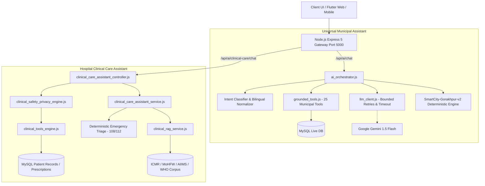

# SmartCity AI — Dual Assistant Architecture Specification
**Date:** October 2026  
**System:** Gorakhpur Smart City & Hospital AI Management Platform  
**Authors:** Senior AI/ML Engineer, Node.js Backend Architect, Healthcare AI Safety Engineer  

---

## 1. System Overview

The platform operates two distinct, purpose-isolated AI decision-support systems sharing a hardened Express / MySQL foundation:



---

## 2. Assistant Responsibilities & Data Boundary Isolation

| Parameter | Universal SmartCity Assistant | Hospital Clinical Care Assistant |
| :--- | :--- | :--- |
| **Domain Scope** | Citywide municipal services, parking, traffic, public hospital/ICU beds, water, waste, police, tourism. | Patient health queries, prescription explanation, medication adherence, diet/prevention, symptom triage, emergency red flags. |
| **API Endpoints** | `POST /api/ai/chat`<br>`POST /api/ai/assistant`<br>`POST /api/ai/tool-call` | `POST /api/ai/clinical-care/chat`<br>`GET /api/ai/clinical-care/patient-context`<br>`POST /api/ai/clinical-care/track-health` |
| **Authentication Policy** | Optional authentication (Citizens & Guests can query public city data). User ID used only for personal parking passes. | **Strict Authentication & RBAC**: Patient queries strictly quarantined to authenticated UHID. Cross-patient access blocked by firewall. |
| **Medical Record Access** | **ZERO ACCESS**: Tools have no access to `patients`, `prescriptions`, or patient dossiers. | Authorized access to authenticated patient's own EHR only. |
| **Emergency Handling** | Routes to `get_emergency_services` (112 Police / 108 Ambulance directory). | Immediate deterministic triage response with 108 helpline; zero LLM latency delay. |

---

## 3. Resilient LLM Gateway (`llm_client.js`)

The LLM integration is abstracted into [backend/services/llm_client.js](file:///d:/cityai_project%20-%20Copy/backend/services/llm_client.js) with the following production safeguards:

1. **Configurable Provider & Model:** Configured via `LLM_PROVIDER`, `GEMINI_MODEL` (`gemini-1.5-flash`), `LLM_TIMEOUT_MS`, and `LLM_MAX_RETRIES`.
2. **Deterministic Timeout:** Uses Node.js `https.request` timeout and AbortController (default 7,500ms) to prevent slow network hangs.
3. **Bounded Retries with Exponential Backoff & Jitter:** Automatically retries transient 429 (rate limit) or 503 (server unavailable) errors up to 2 times with randomized jitter (`Math.random() * 250ms`).
4. **Token Budgeting:** Caps output generation at 800 tokens (`maxOutputTokens: 800`) with factual temperature `0.2`.
5. **Zero Secret Leakage:** Redacts API keys in all diagnostic summaries (`***${key.slice(-4)}`) and sanitizes all errors.
6. **Graceful Fallback:** If `GEMINI_API_KEY` is empty, unset, or if API quota is exhausted, signals `fallback: true` so the system smoothly renders verified municipal facts via the deterministic local engine.

---

## 4. Live Data Grounding & Freshness Specification

All municipal facts are queried directly from live MySQL tables via allowlisted tools in [backend/services/grounded_tools.js](file:///d:/cityai_project%20-%20Copy/backend/services/grounded_tools.js):

* `find_hospital_beds`: Real-time query over `hospitals` and `hospital_ward_beds` with `COUNT()` of available ward and ICU beds.
* `find_parking`: Real-time query over `parking_lots` returning live `available_slots` and hourly rates.
* `get_traffic_status`: Real-time query over `traffic_junctions` and active `traffic_incidents`.
* `get_ambulances`: Live query over `ambulances` filtering `status = 'Available'`.

Every grounded response includes verified provenance metadata:
```json
{
  "success": true,
  "data_source": "REAL",
  "freshness": "LIVE_TRANSACTIONAL",
  "freshness_timestamp": "2026-10-27T09:36:06.103Z",
  "source_system": "MySQL Live Replica",
  "confidence": 0.92
}
```

---

## 5. Clinical RAG Knowledge Pipeline

Clinical decision support is powered by [backend/services/clinical_rag_service.js](file:///d:/cityai_project%20-%20Copy/backend/services/clinical_rag_service.js):

1. **Corpus Ingestion:** Manifest-driven ingestion of authoritative guidelines published by ICMR, MoHFW, AIIMS New Delhi, and WHO.
2. **Hybrid Lexical & Semantic Retrieval:** Combines token n-grams (supporting English, Hindi, and transliterated Hinglish), topic weights, and clinical concept matching.
3. **Attribution Engine:** Dynamically injects formal source citations (Organization, Year, and Document Chapter/Section) into the final clinical advice.
4. **Strict Patient Isolation:** Public clinical guidelines are isolated in memory. Patient EHR tables are never indexed into the RAG vector space.
