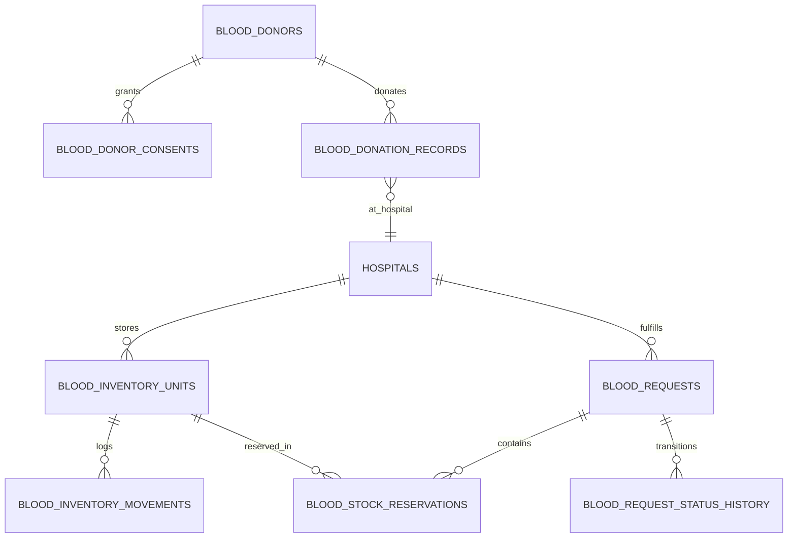

# BLOOD BANK & EMERGENCY BLOOD MANAGEMENT SYSTEM: DATABASE DESIGN
**SmartCity AI – Gorakhpur Municipal Healthcare Ecosystem**
*Document Version: 1.0.0*
*Database Engine: MySQL 8.x / MariaDB (InnoDB Strict)*

---

## 1. Schema Architecture & Design Philosophy
The Blood Bank database is designed under the **Five Pillars of Healthcare Data Integrity**:
1. **Unit-Level Traceability:** Every blood unit is tracked as a distinct physical entity (`unit_identifier`) with collection date, expiry date, screening status, component type, and cold-chain storage location.
2. **FEFO (First-Expired, First-Out) Optimization:** Reservations prioritize units approaching expiry (while strictly enforcing `expiry_date >= CURDATE()` and `screening_status = 'PASSED'`).
3. **Transaction Safety & Pessimistic Concurrency (`SELECT ... FOR UPDATE`):** Eliminates double-reservation, overselling, and race conditions during simultaneous emergency spikes.
4. **Strict Hospital-Level Scoping:** Multi-tenant isolation prevents staff at Hospital A from viewing or modifying units at Hospital B, while Super Admin maintains unified oversight.
5. **Auditing & Immutability:** Unit state changes, status progressions, and donor consent revocations generate immutable ledger records (`blood_inventory_movements`, `blood_request_status_history`, `blood_bank_audit_logs`).

---

## 2. Entity Relationship Overview



---

## 3. Detailed Table Specifications

### 3.1 `blood_inventory_units`
Stores physical blood and blood component units held by verified hospital blood banks.

| Column | Type | Constraints | Description |
|---|---|---|---|
| `id` | INT | AUTO_INCREMENT PK | Internal synthetic key |
| `hospital_id` | VARCHAR(50) | NOT NULL | Assigned hospital ID (e.g. `HOSP-001`) |
| `unit_identifier` | VARCHAR(64) | NOT NULL UNIQUE | Unique barcoded unit code (e.g. `BG-AIIMS-A-POS-1001`) |
| `blood_group` | ENUM | NOT NULL | `'A+', 'A-', 'B+', 'B-', 'AB+', 'AB-', 'O+', 'O-'` |
| `component_type` | ENUM | NOT NULL | `'Whole Blood', 'PRBC', 'Platelets', 'FFP', 'Cryoprecipitate'` |
| `volume_ml` | INT | NOT NULL DEFAULT 350 | Unit volume in milliliters (350ml or 450ml) |
| `collection_date` | DATE | NOT NULL | Date unit was collected from donor |
| `expiry_date` | DATE | NOT NULL | Date unit expires |
| `screening_status` | ENUM | NOT NULL DEFAULT 'PASSED' | `'PENDING', 'PASSED', 'FAILED'` (HIV, HBV, HCV, Syphilis, Malaria) |
| `inventory_status` | ENUM | NOT NULL DEFAULT 'AVAILABLE'| `'AVAILABLE', 'RESERVED', 'ISSUED', 'EXPIRED', 'QUARANTINED', 'DISCARDED'` |
| `storage_location` | VARCHAR(100) | DEFAULT 'Cold Chamber 4°C' | Cold-storage rack or freezer identifier |
| `batch_number` | VARCHAR(50) | NULL | Testing/processing batch identifier |
| `donor_id` | INT | NULL | Reference to `blood_donors.id` if collected locally |
| `created_at` | TIMESTAMP | DEFAULT CURRENT_TIMESTAMP | Creation timestamp |
| `updated_at` | TIMESTAMP | ON UPDATE CURRENT_TIMESTAMP | Last state update timestamp |

**Indexes:**
- `idx_bld_inv_avail`: `(hospital_id, blood_group, component_type, inventory_status, screening_status)`
- `idx_bld_inv_expiry`: `(expiry_date, inventory_status)`

---

### 3.2 `blood_inventory_movements`
Immutable audit ledger tracking every intake, quarantine, reservation, issue, and disposal.

| Column | Type | Constraints | Description |
|---|---|---|---|
| `id` | INT | AUTO_INCREMENT PK | Primary key |
| `unit_id` | INT | NOT NULL | Foreign key to `blood_inventory_units.id` |
| `hospital_id` | VARCHAR(50) | NOT NULL | Hospital identifier |
| `movement_type` | ENUM | NOT NULL | `'INTAKE', 'RESERVATION', 'RESERVATION_RELEASED', 'ISSUED', 'EXPIRED', 'QUARANTINE', 'DISPOSAL', 'ADJUSTMENT'` |
| `previous_status`| VARCHAR(50) | NULL | State prior to movement |
| `new_status` | VARCHAR(50) | NOT NULL | State following movement |
| `performed_by_user_id` | VARCHAR(50) | NULL | Acting user ID |
| `performed_by_name` | VARCHAR(100) | NULL | Acting user name |
| `performed_by_role` | VARCHAR(50) | NULL | Acting user role |
| `request_id` | INT | NULL | Associated request ID if reservation or issue |
| `reason` | TEXT | NULL | Reason for movement or disposal remarks |
| `created_at` | TIMESTAMP | DEFAULT CURRENT_TIMESTAMP | Timestamp |

---

### 3.3 `blood_requests`
Citizen emergency and routine blood requests.

| Column | Type | Constraints | Description |
|---|---|---|---|
| `id` | INT | AUTO_INCREMENT PK | Primary key |
| `request_reference`| VARCHAR(64) | NOT NULL UNIQUE | User-facing tracking code (e.g. `REQ-BLD-2026-9481`) |
| `citizen_id` | INT | NULL | Authenticated user ID (`users.id`) |
| `hospital_id` | VARCHAR(50) | NOT NULL | Requested hospital blood bank |
| `patient_name` | VARCHAR(150) | NOT NULL | Name of patient in need |
| `patient_age` | INT | NULL | Patient age |
| `patient_gender` | VARCHAR(20) | NULL | Patient gender |
| `blood_group` | VARCHAR(10) | NOT NULL | Requested blood group |
| `component_type`| VARCHAR(50) | NOT NULL | Requested component (PRBC, Platelets, etc.) |
| `requested_units`| INT | NOT NULL DEFAULT 1 | Quantity of units required |
| `priority` | ENUM | NOT NULL DEFAULT 'Routine'| `'Routine', 'Urgent', 'Emergency'` |
| `treating_department` | VARCHAR(100) | DEFAULT 'Emergency / Trauma' | Hospital department |
| `treating_doctor`| VARCHAR(100) | NULL | Attending physician |
| `required_at` | DATETIME | NOT NULL | Target transfusion date/time |
| `status` | ENUM | NOT NULL DEFAULT 'SUBMITTED' | Workflow status (see Section 4) |
| `contact_person`| VARCHAR(100) | NOT NULL | Caregiver or requester contact |
| `contact_phone` | VARCHAR(25) | NOT NULL | Verified 10-digit phone number |
| `relationship_to_patient`| VARCHAR(50) | NOT NULL | e.g. Self, Parent, Spouse, Relative |
| `additional_notes`| TEXT | NULL | Clinical context / diagnosis |
| `idempotency_key`| VARCHAR(100) | NULL UNIQUE | Duplicate submission prevention key |
| `rejection_reason`| TEXT | NULL | Staff explanation if rejected |
| `reviewed_by` | VARCHAR(100) | NULL | Medical staff reviewer |
| `reserved_at` | DATETIME | NULL | Timestamp units were locked |
| `fulfilled_at` | DATETIME | NULL | Timestamp blood was physically collected |
| `created_at` | TIMESTAMP | DEFAULT CURRENT_TIMESTAMP | Submission timestamp |
| `updated_at` | TIMESTAMP | ON UPDATE CURRENT_TIMESTAMP | Status update timestamp |

**Indexes:**
- `idx_bld_req_hosp_status`: `(hospital_id, status, priority)`
- `idx_bld_req_citizen`: `(citizen_id, created_at)`

---

### 3.4 `blood_request_status_history`
Maintains an immutable timeline of every request transition.

| Column | Type | Constraints | Description |
|---|---|---|---|
| `id` | INT | AUTO_INCREMENT PK | Primary key |
| `request_id` | INT | NOT NULL | Foreign key to `blood_requests.id` |
| `from_status` | VARCHAR(50) | NULL | Previous workflow status |
| `to_status` | VARCHAR(50) | NOT NULL | New workflow status |
| `changed_by_user_id`| VARCHAR(50) | NULL | User ID who authorized transition |
| `changed_by_name` | VARCHAR(100) | NULL | User name |
| `changed_by_role` | VARCHAR(50) | NULL | User role |
| `remarks` | TEXT | NULL | Explanatory note or verification remarks |
| `created_at` | TIMESTAMP | DEFAULT CURRENT_TIMESTAMP | Transition timestamp |

---

### 3.5 `blood_stock_reservations`
Links approved requests to exact physical inventory units.

| Column | Type | Constraints | Description |
|---|---|---|---|
| `id` | INT | AUTO_INCREMENT PK | Primary key |
| `request_id` | INT | NOT NULL | Reference to `blood_requests.id` |
| `unit_id` | INT | NOT NULL | Reference to `blood_inventory_units.id` |
| `reserved_by_user_id`| VARCHAR(50) | NULL | Staff ID |
| `reserved_at` | TIMESTAMP | DEFAULT CURRENT_TIMESTAMP | Reservation time |
| `expires_at` | DATETIME | NOT NULL | Auto-release deadline (typically 24–48 hours) |
| `status` | ENUM | NOT NULL DEFAULT 'ACTIVE' | `'ACTIVE', 'FULFILLED', 'RELEASED'` |

**Unique Constraint:**
- `uk_active_unit_reservation`: `(unit_id, status)` prevents any unit from being actively reserved more than once simultaneously.

---

### 3.6 `blood_donors`
Voluntary donor registry with privacy protection.

| Column | Type | Constraints | Description |
|---|---|---|---|
| `id` | INT | AUTO_INCREMENT PK | Primary key |
| `citizen_id` | INT | NULL | Associated citizen user ID |
| `donor_code` | VARCHAR(50) | NOT NULL UNIQUE | Masked identifier (e.g. `DNR-GKP-2026-104`) |
| `full_name` | VARCHAR(150) | NOT NULL | Donor's legal name |
| `age` | INT | NOT NULL | Donor age (must be 18–65) |
| `gender` | VARCHAR(20) | NULL | Gender |
| `blood_group` | VARCHAR(10) | NOT NULL | Blood group |
| `phone` | VARCHAR(25) | NOT NULL | Phone number (CONFIDENTIAL: Never exposed to public APIs) |
| `email` | VARCHAR(100) | NULL | Email |
| `city` | VARCHAR(100) | DEFAULT 'Gorakhpur' | City |
| `locality` | VARCHAR(150) | NULL | Neighborhood/Ward |
| `preferred_contact_method` | ENUM | DEFAULT 'Call' | `'Call', 'SMS', 'WhatsApp', 'Email'` |
| `last_donation_date` | DATE | NULL | Date of previous donation |
| `availability_preference` | ENUM | DEFAULT 'Emergency Only' | `'Anytime', 'Weekends Only', 'Emergency Only'` |
| `donor_status` | ENUM | DEFAULT 'PENDING_VERIFICATION' | `'PENDING_VERIFICATION', 'VERIFIED', 'TEMPORARILY_UNAVAILABLE', 'INACTIVE', 'SUSPENDED'` |
| `verified_by_user_id`| VARCHAR(50) | NULL | Verifying medical staff ID |
| `verified_at` | DATETIME | NULL | Verification date |
| `is_consent_active`| TINYINT(1) | DEFAULT 1 | Flag indicating active contact consent |
| `created_at` | TIMESTAMP | DEFAULT CURRENT_TIMESTAMP | Registration date |
| `updated_at` | TIMESTAMP | ON UPDATE CURRENT_TIMESTAMP | Update date |

---

### 3.7 `blood_donor_consents`
Records explicit donor consents and withdrawals according to medical privacy laws.

| Column | Type | Constraints | Description |
|---|---|---|---|
| `id` | INT | AUTO_INCREMENT PK | Primary key |
| `donor_id` | INT | NOT NULL | Reference to `blood_donors.id` |
| `consent_type` | VARCHAR(100) | DEFAULT 'VOLUNTARY_DONATION_CONTACT' | Consent type |
| `granted` | TINYINT(1) | DEFAULT 1 | 1 = Active, 0 = Withdrawn |
| `granted_at` | TIMESTAMP | DEFAULT CURRENT_TIMESTAMP | Timestamp consent was given |
| `withdrawn_at` | DATETIME | NULL | Timestamp consent was withdrawn |
| `ip_address` | VARCHAR(45) | NULL | IP address of request |
| `user_agent` | TEXT | NULL | Client browser string |

---

### 3.8 `blood_donation_records`
Historical records of successful blood donations conducted by verified hospitals.

| Column | Type | Constraints | Description |
|---|---|---|---|
| `id` | INT | AUTO_INCREMENT PK | Primary key |
| `donor_id` | INT | NOT NULL | Reference to `blood_donors.id` |
| `hospital_id` | VARCHAR(50) | NOT NULL | Hospital where donation took place |
| `unit_identifier`| VARCHAR(64) | NULL | Resulting `blood_inventory_units` code |
| `donation_date` | DATE | NOT NULL | Date donation occurred |
| `volume_ml` | INT | DEFAULT 350 | Volume collected (ml) |
| `hemoglobin_g_dl`| DECIMAL(4, 1)| NULL | Donor hemoglobin level (must be >= 12.5) |
| `screening_results`| VARCHAR(50)| DEFAULT 'PASSED' | Clinical screening outcome |
| `staff_notes` | TEXT | NULL | Confidential phlebotomist remarks |
| `created_at` | TIMESTAMP | DEFAULT CURRENT_TIMESTAMP | Log timestamp |

---

### 3.9 `blood_bank_audit_logs`
Audit trail for administrative queries, reports, and manual stock overrides.

| Column | Type | Constraints | Description |
|---|---|---|---|
| `id` | INT | AUTO_INCREMENT PK | Primary key |
| `hospital_id` | VARCHAR(50) | NULL | Target hospital |
| `user_id` | VARCHAR(50) | NULL | Actor ID |
| `user_name` | VARCHAR(100) | NULL | Actor name |
| `role` | VARCHAR(50) | NULL | Actor role |
| `action` | VARCHAR(100) | NOT NULL | e.g. `INVENTORY_ADD`, `REQUEST_APPROVE`, `EXPIRED_DISCARD` |
| `target_type` | VARCHAR(50) | NULL | e.g. `UNIT`, `REQUEST`, `DONOR` |
| `target_id` | VARCHAR(64) | NULL | Identifier of affected entity |
| `details` | TEXT | NULL | JSON or textual specifics |
| `ip_address` | VARCHAR(45) | NULL | Remote IP |
| `created_at` | TIMESTAMP | DEFAULT CURRENT_TIMESTAMP | Audit timestamp |

---

## 4. Status Workflows

### 4.1 Blood Request Workflow
```
SUBMITTED
   │
   ▼
UNDER_REVIEW
   │
   ▼
VERIFIED ──────────► REJECTED (Terminal)
   │
   ▼
APPROVED ──────────► CANCELLED (Terminal)
   │
   ▼
RESERVED (Units locked in InnoDB via SELECT ... FOR UPDATE)
   │
   ▼
READY_FOR_COLLECTION ─► EXPIRED (If uncollected within 24–48h)
   │
   ▼
FULFILLED (Blood issued to patient/attendant)
```

### 4.2 Blood Unit Inventory Lifecycle
```
COLLECTED (Pending screening)
   │
   ├── [Failed Screening] ──► DISCARDED / QUARANTINED
   │
   └── [Passed Screening] ──► AVAILABLE
                                  │
                                  ├── [Overdue Expiry] ────► EXPIRED ──► DISCARDED
                                  │
                                  └── [Emergency Request] ──► RESERVED
                                                                  │
                                                                  ├── [Request Cancelled] ──► AVAILABLE
                                                                  │
                                                                  └── [Dispatched] ────────► ISSUED
```
